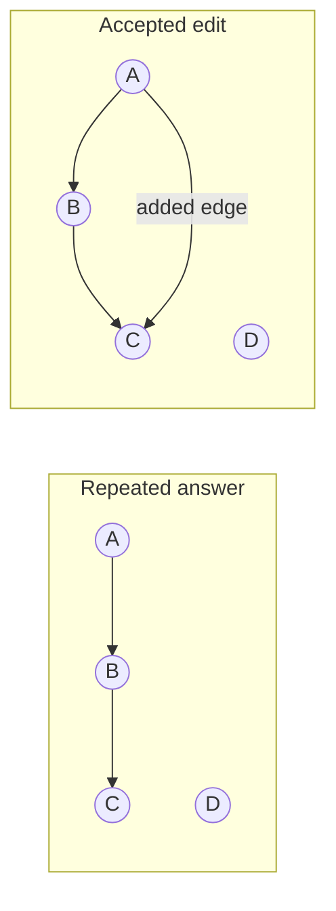

# Learning to recover more causal graphs on HypoSpace

Can a small model turn a repeated correct answer from a language model into a different correct answer? We study this question on the causal-graph task in HypoSpace. We freeze Qwen3.8-27B, train a multilayer perceptron (MLP) to rank single-edge edits on four-node graphs, and test the frozen ranker on five-node graphs.

**Main result.** On 30 five-node questions, random editing recovered **93** distinct valid graphs. The learned selector recovered **179**. Both methods used the same 360 recorded Qwen answers and exactly 205 candidate checks. They preserved the same 240 valid submissions. Graphs are counted once per question.

The complete experiment is in [hypospace.py](hypospace.py), including compact records of the original generations. The default command runs offline.

## Original HypoSpace benchmark

The [authors' benchmark](benchmark/HypoSpace) is included as a Git submodule pinned to [commit c69e931](https://github.com/CTT-Pavilion/_HypoSpace/tree/c69e9318577b34b5b896996571aefd4ba6053f58). Opening that directory on GitHub shows the original source at the pinned revision.

| Official domain | Dataset generator | Benchmark runner |
|---|---|---|
| Causal graphs | [generate_causal_dataset.py](https://github.com/CTT-Pavilion/_HypoSpace/blob/c69e9318577b34b5b896996571aefd4ba6053f58/causal/generate_causal_dataset.py) | [run_causal_benchmark.py](https://github.com/CTT-Pavilion/_HypoSpace/blob/c69e9318577b34b5b896996571aefd4ba6053f58/causal/run_causal_benchmark.py) |
| 3D voxel reconstruction | [generate_3d_dataset_complete.py](https://github.com/CTT-Pavilion/_HypoSpace/blob/c69e9318577b34b5b896996571aefd4ba6053f58/3d/generate_3d_dataset_complete.py) | [run_3d_benchmark.py](https://github.com/CTT-Pavilion/_HypoSpace/blob/c69e9318577b34b5b896996571aefd4ba6053f58/3d/run_3d_benchmark.py) |
| Boolean programs | [boolean_dataset.py](https://github.com/CTT-Pavilion/_HypoSpace/blob/c69e9318577b34b5b896996571aefd4ba6053f58/boolean/boolean_dataset.py) | [boolean_benchmark.py](https://github.com/CTT-Pavilion/_HypoSpace/blob/c69e9318577b34b5b896996571aefd4ba6053f58/boolean/boolean_benchmark.py) |

Our reported experiments cover the causal domain only. The Qwen baseline uses our prompt and a fixed budget of 12 submissions per question. The standalone replay in `hypospace.py` reconstructs the compatible DAG sets for our recorded questions, then evaluates the learned edit selector. For the authors' original runner, configurations and usage examples, see the [upstream README](https://github.com/CTT-Pavilion/_HypoSpace/blob/c69e9318577b34b5b896996571aefd4ba6053f58/README.md).

## Reproduce the results

Use Python 3.10 or later. From a terminal:

```bash
git clone --recurse-submodules https://github.com/tzhang8x/hypospace-edge-selector.git
cd hypospace-edge-selector
python -m pip install numpy networkx
python hypospace.py --output results
```

For an existing checkout, run `git submodule update --init --recursive` to fetch the original benchmark. Use a fresh output directory to reproduce the published run. The script enumerates the possible directed acyclic graphs (DAGs), reconstructs the questions, trains the ranker, and writes three files.

| Output | What to look for |
|---|---|
| `results/report.json` | Four-node results. `splits` records the held-out questions. `episodes` gives recovery, distinct graphs and checks for each question and policy. |
| `results/edit-mlp.npz` | Final weights trained on the full four-node dataset after cross-validation. |
| `results/five-node-report.json` | Frozen-model transfer results. In `summary`, the row with `policy="mlp"` and `k=1` has `distinct=179`, `checks=205` and `correct=240`. |

## A worked example

Suppose perturbing **A** affects **B** and **C**, while **D** stays unchanged. Qwen returns `Graph: A->B, B->C`. That chain explains the observation because C is reachable from A through B. If Qwen returns the same chain again, the second answer also passes the verifier, but the question still has only one distinct answer.

The selector considers adding or removing one directed edge. Adding `A->C` gives a new explanation with both a direct and an indirect path to C. Removing `B->C` destroys the only path from A to C and fails verification. This figure shows the successful edit in the illustrative example.



For each question, the replay keeps a record of the graphs already submitted. A first valid answer is kept. When a valid graph is repeated, the algorithm excludes edits whose result is already in that record, ranks the remaining candidates, and verifies up to **K** candidates in order. It accepts the first valid edit. If all checks fail, it keeps the original answer. Invalid Qwen outputs retain their original score. This fallback accounts for the preserved validity. The ranking determines how many different valid answers are found.

## What the MLP learns

Training starts with valid graphs that appeared at least twice in the four-node Qwen answers for a question. Each candidate toggles one directed edge. The training target is whether the edited graph remains acyclic and reproduces all observed intervention effects. An exact verifier generates those labels.

The model sees 24 features describing the **current graph and proposed edge**. These include edge direction and reachability, normalized endpoint degrees, paths through intermediate nodes, and the observed intervention effects at both endpoints. The feature dimension stays constant as the number of nodes changes. Identical feature vectors are grouped and their training labels averaged. The NumPy MLP uses one hidden layer with 32 tanh units and trains with Adam for 800 minibatch updates. At test time the MLP scores candidates before verification.

## Evaluation protocol

| | Four-node evaluation | Five-node transfer |
|---|---:|---:|
| Questions | 236 | 30 |
| Recorded Qwen answers per question | 12 | 12 |
| Total answers | 2,832 | 360 |
| Model used for scoring edits | Five-fold cross-validation | Frozen model trained on all four-node data |

The four-node questions form 17 families under node renaming. Equivalent questions stay in the same fold. The five-node questions were sampled with seed 41 from 1,260 feasible sets of one or two intervention observations. All 30 selected questions happened to contain two separate single-node interventions. Five-node answers and labels were excluded from fitting.

**Validity** is the fraction of submitted graphs that satisfy every observation. **Recovery** is computed separately for each question: divide the number of distinct valid graphs submitted by the total number of compatible DAGs. The tables report the mean of those fractions. For example, finding 2 of 10 solutions and 2 of 40 solutions on two questions gives mean recovery of 12.5%.

## Results

Each edit policy below may check **one candidate per repeated valid submission**. Fixed order, random order and the learned order use the same candidate set and verifier. Qwen alone submits the recorded answers unchanged.

| Policy | Four-node mean recovery | Distinct graphs | Five-node mean recovery | Distinct graphs |
|---|---:|---:|---:|---:|
| Qwen alone | 15.69% | 323 | 3.36% | 35 |
| Fixed order | 19.17% | 479 | 3.92% | 58 |
| Random order | 24.35% | 648 | 6.46% | 93 |
| **MLP ranking** | **34.81%** | **998** | **11.79%** | **179** |

The five-node MLP improved mean recovery by **5.33 percentage points** over random selection. It found more valid graphs on 27 questions and tied on the other three. Validity was 66.00% on four nodes and 66.67% on five nodes for every policy.

Allowing up to **three** checks gives a second comparison on five nodes. Random editing reaches 8.70% recovery with 482 candidate checks. The MLP reaches 11.79% with 327 checks. Compared with its own one-check result, the MLP spent additional checks without discovering additional graphs on this sample.

## What the experiment establishes

The experiment measures **offline post-processing of a fixed generation history**. Every method receives the same ordered Qwen answers. An accepted edit changes the submissions used for deduplication, while the next Qwen answer remains the one originally recorded. Whether feeding edits back into the prompt improves subsequent generations is an open question.

The transfer test covers 30 five-node causal questions, a single backbone and a fixed random-policy seed. Compare policies within each column. The four- and five-node question sets differ in their observation patterns and solution counts. Other HypoSpace domains require their own edit operations and verifiers.

## Optional: collect a fresh Qwen baseline

The optional collector sends real API requests to Alibaba Cloud DashScope (Beijing) and consumes the account's token quota. Set `DASHSCOPE_API_KEY` in the environment of the terminal running Python. To collect five-node answers and replay them with the four-node model:

```bash
python hypospace.py --collect 5 --output fresh-run
python hypospace.py --output fresh-run
```

Collection saves each completed draw to `fresh-run/draws-5.json`. Rerun the first command to resume. Replay uses the fresh draws for that size and the embedded records for the other size. Use `--collect 4` to collect all 2,832 four-node answers. Fresh outputs can differ from the recorded run even with the same seeds.

## Source guide

| To inspect… | Start with… |
|---|---|
| The graph features and training objective | `TransferEpisode.features` and `fit` |
| Candidate ranking, deduplication and fallback | `replay` |
| The recorded questions and graph masks | `SAMPLES` and `questions` |
| Enumeration of legal DAGs and exact answer sets | `dag_archive` and `load_groups` |
| Family splits and frozen transfer | `train_four` and `evaluate` |
| API prompts, output parsing and checkpointing | `collect` and `parse_mask` |

The task and benchmark metrics come from *HypoSpace: A Diagnostic Benchmark for Set-Valued Hypothesis Generation under Underdetermination and Sublinear Coverage Bounds*. This repository implements the edge-selection experiment. [Benchmark paper](https://arxiv.org/abs/2510.15614) · [Authors' implementation](https://github.com/CTT-Pavilion/_HypoSpace)
